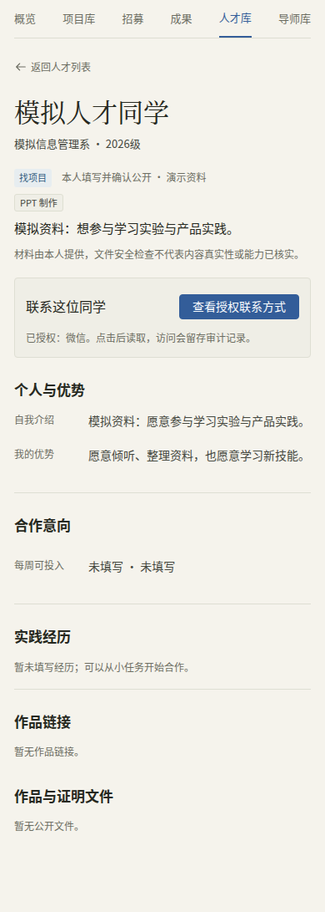
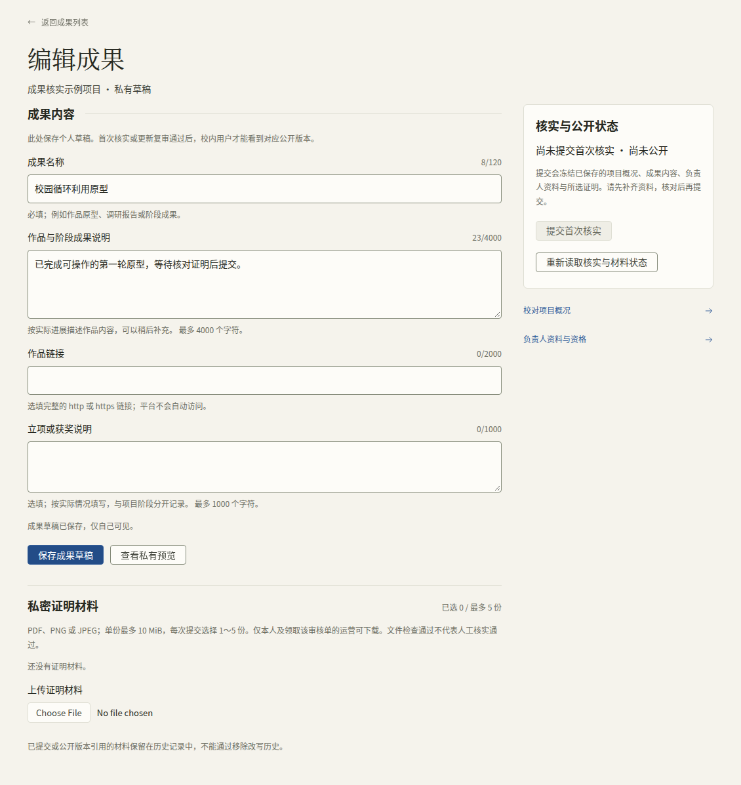
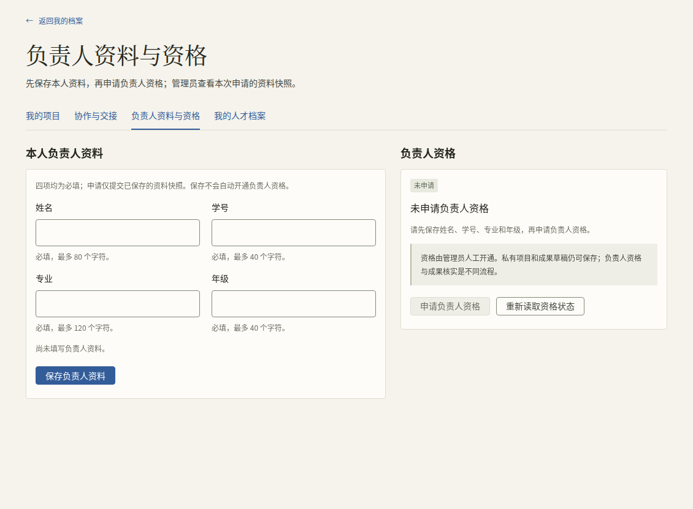
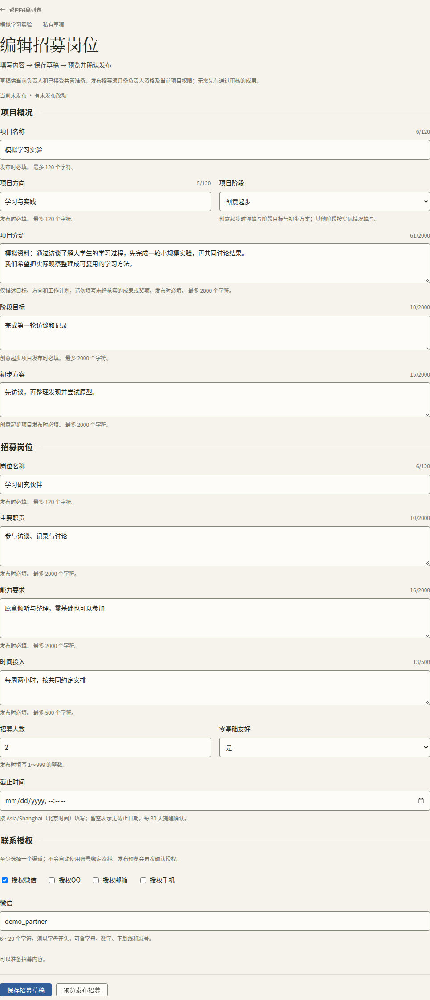
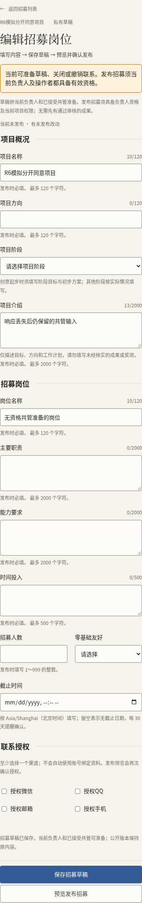
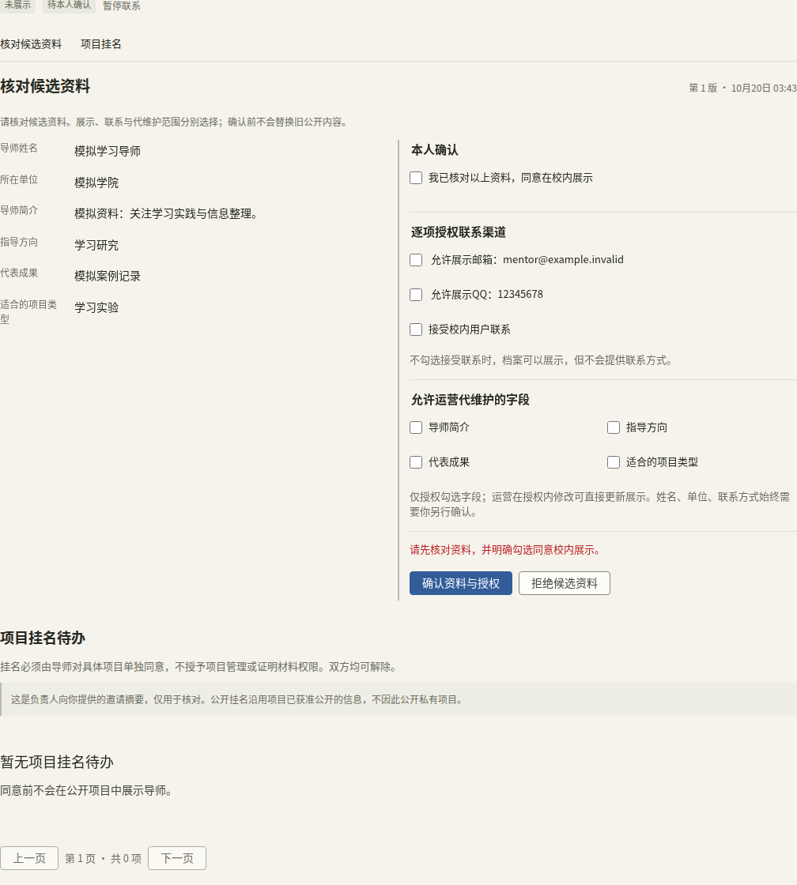
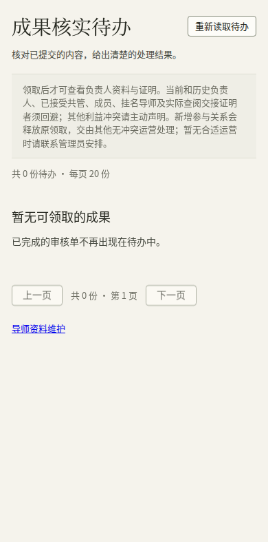
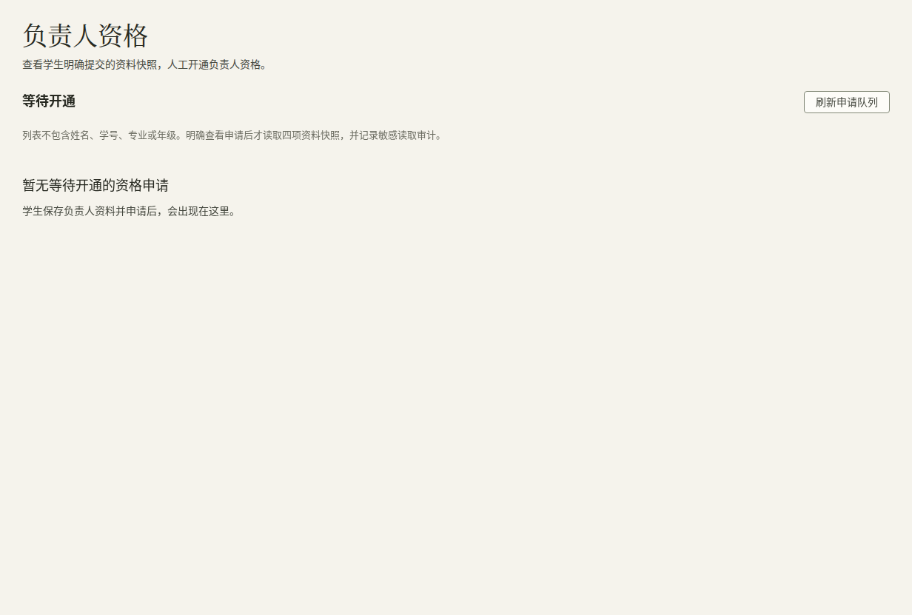

# 华师令双创操作指南（R1–R6）

> 本地核验版：入口、按钮和20张页面截图按 R6 当前实现核对；完整功能及专用视觉检查已通过，最终提交独立评审另见验证记录。本文不含登录凭据；所有演示人物、项目和证明均为模拟资料。学校 SSO 最后接入，当前模拟登录不代表学校身份系统。

跟随指南操作前，先取得所用环境的地址及对应账号，核对学生、导师或管理员身份，以及负责人资格、共同管理和运营等实际授权。自动验收账号是临时生成、运行结束后清理的；截图昵称不是登录凭据，不能直接照抄登录。环境地址与私有凭据由项目维护方另行交付，不放在本指南或公开截图中。

## 一页速查

校内浏览须先登录。保存草稿只保存工作内容；明确的发布或成果核实通过，才改变校内公开版本。

| 想做什么 | 入口 | 准备与身份 | 完成后的结果 |
| --- | --- | --- | --- |
| 找项目、成果和招募 | 创新创业 → 项目 / 成果 / 招募 | 已登录的正常学生、教师或管理员账号 | 看到当前可公开版本；招募标明免审，成果单独说明核实事实 |
| 建项目与整理成果 | 我的 → 我的项目 | 正常学生；先存项目再建成果 | 私有草稿；上传证明与提交核实另行操作 |
| 开通负责人资格 | 我的 → 负责人资料与资格 | 本人资料；管理员核对申请快照 | 可按资格提交成果、发布招募及邀请导师；草稿不因申请自动公开 |
| 准备或开放招募 | 项目 → 招募管理；共管从协作工作区进入 | 草稿：当前负责人或已接受共管；发布：实际发布者及当前负责人资格均有效 | 草稿另行保存；预览并明确发布，联系渠道逐项授权 |
| 介绍自己、寻找合作 | 我的 → 人才档案；创新创业 → 人才 | 正常学生本人 | 保存人才草稿，另行预览开启或更新校内展示 |
| 找导师、确认项目挂名 | 创新创业 → 导师；导师本人从导师登录进入 | 运营维护候选资料，导师本人确认展示；项目挂名再单独同意 | 资料、联系、代维护与项目挂名分别生效 |
| 共同管理或同意挂名 | 我的 → 协作与交接 | 邀请对象本人，无需先开通负责人资格 | 管理与公开姓名/分工分别同意，可分别退出 |
| 交给新负责人 | 协作工作区 → 交给新负责人 | 当前负责人发起；接任人资格有效；没有待核实成果 | 对方确认后原子交接，关闭已有招募，旧联系授权撤销 |
| 结项、恢复与更正介绍 | 协作工作区 → 项目状态与公开介绍 | 当前负责人处理状态；公开更正须资格有效 | 保留合规的此前公开介绍，岗位及关系不会自动恢复 |
| 核实成果或协调回避 | 双创运营工作台；管理员运营授权页 | 管理员指定的正常学生运营；具体项目无利益冲突 | 领取后核对固定版本；回避后由其他无冲突运营处理 |

“阶段”用于描述项目进展，“进行中 / 已结项”是独立状态。“已结项”“正在招募”“已核实成果”也分别表示不同事实。

## 普通学生：浏览与人才档案

1. 登录后进入创新创业，按项目、成果、招募、人才或导师浏览。
2. 项目页查看当前介绍的来源：已核实成果、负责人发布的免审招募，或从此前公开来源留存的介绍。留存介绍可以更正，不等于整项项目已认证。
3. 成果详情以各自通过核实的版本为准。更新复审期间，旧通过版本继续展示；私稿、证明和核实用负责人资料不在公开内容中。
4. 招募须看岗位状态与截止时间。联系入口只有在当前渠道被明确授权且仍有效时才提供；失效后重新核对，不沿用之前看到的联系值。
5. 在“我的人才档案”先填写必填的“一句话介绍”并保存草稿，按需要上传文件、完善能力、合作状态与联系渠道，再按页面补齐公开必填资料，选择“预览开启校内展示”或“预览更新公开档案”，核对后确认。保存不自动替换展示。
6. 不想继续展示时选择“关闭校内展示”；只撤回某个联系渠道，使用相应“立即撤回…授权”。公开展示和联系授权分别管理。

列表的“含作品/证明材料”只表示公开档案当前有已就绪且仍授权的文件；文件安全检查不等于内容真实性或能力核实。文件加入草稿后，仍需明确更新公开档案才会进入展示。

## 负责人：从草稿到公开

### 资料、项目与成果

1. 进入负责人资料与资格，保存本人资料，再申请负责人资格。管理员核对的是申请时的资料快照；资料有变动时按页面提示更新申请。
2. 在“我的项目”新建并保存项目。项目名称、简介、方向、阶段和团队现状都属于草稿，保存成功不代表公开。
3. 进入成果草稿，保存成果文字后上传所需证明；文件须检查就绪后才能用于核实。证明只供被授权流程使用，不会因此进入公开项目页。
4. 核对已保存的项目和成果版本后提交首次核实。被退回时看具体原因，修改并重新提交；需要先修改待审内容时，由负责人撤回本次待审，再保存后重提。
5. 已有公开成果需要更新时，提交更新复审。通过后才替换公开成果版本；退回不抹去原已通过版本。

共管的文字入口不包含证明、成果提审、团队授权、导师管理、转让和生命周期操作。需要这些动作时由当前负责人处理。

### 招募与联系

1. 打开项目招募管理，新建岗位，核对项目概况、岗位职责、人数、要求和未来截止时间。
2. 保存招募草稿；预览并明确发布后才开放。选择具体联系渠道，填写相应值，逐项授权校内展示。
3. 修改草稿不自动更新公开岗位；再次预览确认。关闭岗位、撤销联系授权和结项是不同动作。
4. 交接或结项后，岗位会关闭。恢复项目状态不会自动开放这些岗位。

### 邀请共同管理与公开挂名

1. 从“协作与交接 → 我负责的 → 协作工作区”进入项目。
2. 在“定向邀请”选择本次用途，输入对方提供的账号并“核对对象”。核对后只显示昵称，检查对象再发送。
3. 共同管理与公开挂名各发一项邀请。公开挂名还须填写候选姓名及分工，由对方逐次确认；管理邀请不会同时公开姓名。
4. 需要改公开姓名或分工时，发送新候选。对方未确认或拒绝新候选时，旧有效同意继续展示。
5. 项目协作记录可撤销尚未接受的邀请、撤销共同管理或撤下公开挂名。只结束所选用途，历史参与记录保留用于审核回避。

## 共同管理员：文字与按资格招募

1. 在“我的 → 协作与交接”的“协作邀请与同意”找到邀请，核对项目名称、方向与简介，再明确“同意共同管理”。没有接受前没有编辑权。
2. 从“我共管的”进入协作工作区，编辑项目五项文字，或进入“成果文字”新建、整理成果说明。这里不提供证明或提审操作。
3. 无负责人资格时，可以先准备招募草稿，再请当前负责人核对发布。本人及当前负责人都具备有效资格、且其他公开条件满足后，可以按共管权限发布招募；系统每次执行时重新检查条件。
4. 多人保存出现冲突时，当前输入仍保留。“读取最新文字（保留输入）”用于比较服务器新内容；明确选择载入才替换本地输入。不要靠反复点击保存覆盖他人的新稿。
5. 不再参与时，从本人邀请与历史记录“退出共同管理”。公开挂名是另一项同意，按需要另行撤下。

## 成员：本人决定公开姓名与分工

1. 无需编辑权或负责人资格，直接进入“协作与交接 → 协作邀请与同意”。历史较多时使用分页找回。
2. 核对具体项目、候选姓名和分工，再选择“同意公开挂名”或“拒绝公开挂名”。同意后只公开这次已确认的内容，不授予项目管理权。
3. 新候选与旧有效同意分别记录。拒绝新候选保留旧公开内容；希望停止该用途时，选择“撤下公开挂名”，当前及待定的该用途都会结束。
4. “我参与的”展示本人有效同意的项目。能够打开的校内公开页只取决于项目当前公开条件，挂名不把私有项目变公开。

## 导师：资料授权与项目挂名

1. 使用导师登录入口。尚未绑定资料时联系双创运营建立候选资料并绑定账号；普通学生账号不能代替导师本人确认。
2. 在“我的导师资料 → 核对候选资料”检查资料；逐项决定校内展示、联系渠道、是否接受联系及运营代维护范围，再“确认资料与授权”。没有确认的新候选不替换旧公开内容。
3. 在“项目挂名待办”查看负责人提供的项目摘要，逐个“同意此项目挂名”或拒绝。资料展示授权不等于同意全部项目挂名。
4. “暂停联系”保留导师资料；撤销单个渠道停止该渠道；“撤回导师展示”会停止资料展示、清空代维护范围并解除项目挂名。重新确认资料不会复活旧挂名。
5. 导师项目挂名不开放项目管理或证明材料权限。导师真实参与历史仍用于成果审核回避。

## 转让：双方都能找回结果

### 原负责人发起

1. 在协作工作区“交给新负责人”核对接任对象。原负责人无需仍具发布资格，接任人必须有有效负责人资格。
2. 如仍有待核实成果，先等结果，或由当前负责人撤回；不要跳过核实阻塞直接交接。
3. 逐份选择允许交接的已就绪证明，最多100份。不选的证明及资格申请资料不在移交范围。
4. 是否允许对方在接任前主动查阅，是单独的选择。发出邀请不表示对方已读取，也不立即改变负责人。
5. 核对对象、选中证明及后果，明确发起。双方从“协作与交接 → 项目交接”打开本次记录。

### 接任人确认

1. 打开交接记录，查看当前项目概况、已接受的管理/成员/导师关系及各自范围、将关闭的具体岗位。
2. 查看“发起时清单”及变化提示。历史旧记录若未记录具体名单，页面会明示未记录，不用当前名单冒充当时事实。
3. 只有发起人另行授权时，才有“主动查阅证明”。每次确认读取前，页面说明实际查阅会形成持久审计和审核回避；拒绝交接也不删除已发生的查阅历史。未选证明不可读取。
4. 资料在确认期间变化时，旧确认会被拒绝。“读取最新交接摘要”后重新核对当前内容与后果，再确认接任。
5. 生效后原负责人失去全部管理权；其他已接受关系按原范围保留，待定邀请失效。原上传合同与删除权限不随证明移交。
6. 从结果中的“逐岗核对招募与新联系授权”逐个打开岗位，核对内容、未来截止时间及新的联系渠道，保存后明确重新开放。原负责人联系值及旧授权不默认带入。

邀请和交接默认有效期为7天，这是当前工程配置，界面展示实际到期时间，不代表学校审批制度。取消、拒绝、到期或材料变化后，旧读取/确认不会恢复授权。

### 结果不明时

网络断开或响应丢失时，先选择“核对原操作结果”。页面保留本账号当前工作区的原请求、版本与输入，先查询再处理；不要另发新请求。换页可从本人交接记录找回终态。

原负责人失权后仍能看双方最小交接结果，不能通过旧创建请求取回现项目私稿、证明或联系。新负责人以实际交接结果进入新工作区。

## 结项、恢复与更正公开介绍

1. 当前负责人在协作工作区“项目状态与公开介绍”选择“预览结项后果”，核对本次关闭的岗位及公开后果，再确认。
2. 曾真实公开且当前可留存的项目会保留最后公开介绍。仅招募公开的来源仍明确免审，页面可显示“暂无已核实成果”。从未公开的私有项目仍然私有。
3. 原公开来源或档案被治理限制时，结项或恢复不能绕过限制。不要把更正介绍当成首次公开私稿的入口。
4. 更正只含标题、正文、方向、阶段四项文字。先“生成介绍预览”，核对来源及待发布内容，再由资格有效的当前负责人“核对并发布此介绍”。新版本保留记录，历史成果核实快照不被改写。
5. 共管可整理与预览介绍，明确发布仍由当前负责人处理。补充成果继续走原首次核实或更新复审。
6. “恢复为进行中”只改项目状态。已公开介绍按原规则继续可见；岗位、旧邀请、挂名和联系授权都不会自动恢复。

## 双创运营：核实与回避

1. 管理员授予双创运营身份后，从“双创运营工作台”进入成果核实待办。
2. 先核对是否应回避。当前或历史负责人、已接受共管、已同意成员/导师、实际读取交接证明者，都不能核实该项目。仅收到邀请不自动认定参与；其他利益冲突请主动声明。
3. 领取后才可查看本次固定提交快照、核实用负责人资料及证明。通过首次核实或更新复审前核对具体版本；退回须给出原因。
4. 已领取后新加入参与关系，原领取会释放，后续详情、证明读取和决定也会拒绝。停止处理并返回待办，由其他无冲突运营继续；没有合适运营时联系管理员安排，不能借回避跳过核实。
5. 导师候选资料维护另从导师资料维护进入。公开、联系及代维护以导师本人当前授权为准，越界修改须本人重新确认。

## 管理员：资格、授权与协调

1. 从管理端负责人资格申请页查看具体申请快照，核对后批准。遇到版本变化时读取最新申请，不批准旧页面里的过期资料。
2. 在双创运营授权页核对账号、填写操作原因后授予或撤回运营身份。管理员身份不自动授予全部成果私密材料的读取权。
3. 回避后无人可处理时，安排合资格且无冲突的运营承接。保留审核流程及历史决定，不为推进进度临时绕过回避条件。
4. 遇到受治理限制的来源或档案，记录页面提示并交项目维护方核实处理，完成后重新读取。当前页面不提供解除限制的操作；普通结项、更正介绍、恢复均不清除治理状态。

## 常见异常速查

| 页面情况 | 下一步 |
| --- | --- |
| 找不到邀请或交接结果 | 我的 → 协作与交接；看本人邀请与历史、项目交接及下一页，无需先取得项目编辑权 |
| 能存招募草稿但不能发布 | 共管先交当前负责人核对；本人和当前负责人资格有效后再尝试明确发布 |
| 保存提示版本或权限变化 | 保留当前输入，读取最新文字比较；明确决定是否载入，不用旧版本强行覆盖 |
| 提示仍有待核实成果 | 等结果或由负责人撤回；处理完后再发起/核对交接 |
| 旧交接确认被拒绝 | 读取最新摘要，比较关系、岗位、材料和公开版本；材料已换时取消并重新逐份选择 |
| 提前查阅按钮没有出现 | 核对是否为指定接任人、当前有效记录，以及发起人是否另行授权；摘要可看不等于证明可读 |
| 写操作结果未知 | 协作/交接用“核对原操作结果”；招募/人才档案用“重试原请求”；成果提审用“确认上次提交结果（沿用原请求）”。均沿用原请求，不改变载荷后重发同一请求 |
| 招募在交接/恢复后仍关闭 | 按结果入口逐岗核对并重新授权联系，再明确开放 |
| 结项后没有公开页 | 从未公开或来源受限制时仍私有；不能借结项首次公开 |
| 运营材料突然不可读 | 停止核实，返回待办；由其他无冲突运营或管理员协调承接 |

切换账号会清除该账号的私有恢复范围，迟到响应不得带入新账号。交接结果以双方本人记录为准；登录凭据、真实手机号/学号/邮箱、真实私密证明及对象存储地址不用于公共截图。图中的模拟联系值仅用于说明逐项授权，不是可用的个人联系方式。

## 核验及截图索引

本稿的自动化证据与验收状态见 [验证记录](../quality/innovation-collaboration-verification.md) 和 [C01–C22矩阵](../quality/test-matrix/innovation-collaboration.md)。以下截图来自隔离模拟世界中实际运行的页面，人物及证明均非真实校内资料；仅截取所属内容区，并隐藏区域外固定导航，方便阅读长图，业务字段及错误提示未遮盖。旧 UI13/14 记录属于来源工作线，不能替代 R6 当前验收。

每张图的原始尺寸、SHA256、来源日志和模拟范围见[截图清单](assets/innovation-r1-r6/manifest.json)。

| 角色或情况 | 实际截图 | 图中状态与证据 |
| --- | --- | --- |
| 负责人准备资料和项目 | [资料与资格](assets/innovation-r1-r6/r1-owner-profile.png)、[新建项目草稿](assets/innovation-r1-r6/r1-project-draft.png) | 初始未填写/未申请状态；保存资料、申请资格及保存项目是三个独立动作 |
| 管理员资格及授权入口 | [资格申请队列](assets/innovation-r1-r6/r1-admin-qualification.png)、[运营授权](assets/innovation-r1-r6/r1-admin-operations.png) | 队列当前为空；授权页先选择账号再读取当前授权，不自动读取私密资格快照 |
| 负责人准备成果与证明 | [成果草稿及私密材料区](assets/innovation-r1-r6/r2-achievement-proof-workspace.png) | 私有模拟草稿，当前无证明且未提审；检查通过和人工核实是不同状态 |
| 负责人准备招募 | [招募编辑及联系授权](assets/innovation-r1-r6/r3-recruitment-owner-form.png) | 模拟免审招募草稿；项目概况、岗位和微信授权分别填写，尚未发布 |
| 普通学生的人才展示 | [390px公开人才档案](assets/innovation-r1-r6/r4-talent-public-mobile.png) | 模拟本人已确认展示；联系值未直接露出，当前暂无公开文件，不表示能力已核实 |
| 导师本人核对候选 | [本人确认及分项授权](assets/innovation-r1-r6/r5-mentor-confirmation.png) | 当前尚未确认，提示先核对并勾选；模拟联系值不代表有效账号，项目挂名另行同意 |
| 成员本人同意后 | [公开姓名与分工](assets/innovation-r1-r6/r6-member-consent-public.png) | 只展示模拟本人已同意的姓名与分工，包含范围说明；不表示身份认证 |
| 共管准备招募 | [手机招募草稿](assets/innovation-r1-r6/r6-manager-unqualified-recruitment-390.png) | 390px，无资格可准备文字；页面说明发布须当前负责人及实际操作者均具备资格 |
| 接任人核对变化 | [手机交接摘要及具体后果](assets/innovation-r1-r6/r6-transfer-current-mobile.png) | 390px，真实前后摘要变化、具体岗位及逐份证明清单；未授权提前查阅时没有读取按钮 |
| 原负责人未开通资格 | [手机发起空证明交接](assets/innovation-r1-r6/r6-unqualified-owner-transfer-390.png) | 390px，已有成果文字草稿；原证明操作仍不可用，能够明确不选证明并发起交接，接任人资格仍有效 |
| 负责人仅有招募公开后结项 | [手机留存介绍](assets/innovation-r1-r6/r6-archive-390.png)、[桌面留存介绍](assets/innovation-r1-r6/r6-archive-1440.png) | 来源仍标明免审、岗位关闭、暂无已核实成果；不把留存介绍称为项目认证 |
| 从未公开的负责人项目 | [私有项目结项](assets/innovation-r1-r6/r6-private-completed.png) | 实际私有项目结项后仍不可首次发布介绍 |
| 已参与项目的运营 | [回避及协调去向](assets/innovation-r1-r6/r6-review-conflict-coordination.png) | 真实领取后接受参与关系，材料读取被拒绝、项目从待办排除；说明由其他无冲突运营或管理员安排 |
| 本人历史长列表 | [390px长内容](assets/innovation-r1-r6/r6-member-list-long-390.png)、[1440px长内容](assets/innovation-r1-r6/r6-member-list-long-1440.png) | 路由模拟21项及超长文本，第2页键盘操作后聚焦标题；不把模拟列表当成真实业务记录 |
| 手机加载与暂时不可用 | [模拟慢响应](assets/innovation-r1-r6/r6-list-loading-simulated-390.png)、[模拟503及重试入口](assets/innovation-r1-r6/r6-list-error-simulated-390.png) | 390px，路由模拟；加载另有辅助技术播报，失败不显示内部错误内容，重试保留当前分类 |

截图用于说明各自状态，并非同一轮统一重拍，也不是一套可照抄登录的账号。清单保留每图的来源、完整运行或单场景通过范围，以及网络/长列表模拟边界；部分R6素材来自早期整体失败运行中的已通过场景，不将该旧轮视作通过。修后完整默认检查为256通过、46具名配置豁免、零失败，原no-skip通过；R1–R6专用视觉及导师world另行完整通过。最终源码范围、实际提交评审和完整日志以验证记录为准。
